# Novel Gene Characterization

Characterizing an unidentified eukaryotic gene from sequence alone — promoter through predicted protein structure — using only public databases and prediction servers.

**Finding:** the sequence encodes a mammary-specific, exon-shuffled gene whose product is a type I single-pass transmembrane protein with two extracellular immunoglobulin V-type domains and an intracellular serine/threonine kinase domain. Conserved and non-conserved exons alternate, which a single ancestral gene diverging over time does not explain.

---

## The problem

Three anonymized sequences were provided with no annotation:

| Input | Length | What it is |
|:--|:--|:--|
| Promoter region | 2,053 bp | Upstream regulatory sequence |
| Genomic sequence | 5,121 bp | The gene, 5 exons |
| mRNA transcript | 2,581 bp | The spliced product |

Three questions: **what gene is this, where is it expressed, and how did it arise?**

---

## Approach

```
PROMOTER                    GENE                      mRNA → PROTEIN
────────                    ────                      ──────────────
BLASTn       identity       BLASTn      identity      BLAST2seq    splice check
FPROM        TATA box       per-exon    shuffling     ORF Finder   coding frame
PROMO 2.0    TSS            BLASTn                    BLASTp       homology
CpG Finder   regulation                               CD-Search    domains
GTEx         tissue                                   PROSITE      motifs
                                                      SignalP 6.0  secretion
                                                      DeepTMHMM    topology
                                                      PSIPRED      2° structure
                                                      SWISS-MODEL  3D model
```

---

## 1 · The promoter is mammary-specific and regulated

BLASTn against nr/nt returned the murine butyrophilin **BTN1A1** promoter (U67065.1) at **100% identity, E = 0.0** — a gene central to milk lipid secretion. Remaining hits were BTN1A1 mutant alleles, mouse chromosome 13 clones, and *Apodemus* genomes.

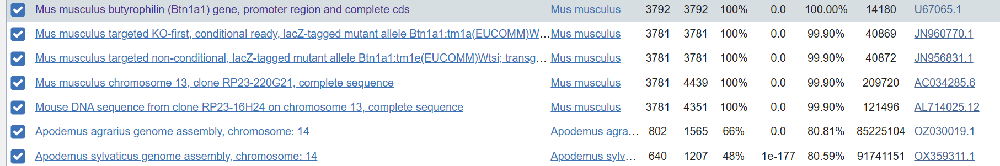

**FPROM** found two promoters in the 2,053 bp window: a strong one at 1554 bp (score +5.574) with a defined TATA box at 1525 bp, and a weak one at 315 bp (score +0.976) with a degenerate TATA-like motif.

**PROMO 2.0** predicted three transcription start sites — marginal calls at 400 and 1000 bp, and a high-confidence call at 1700 bp (score 1.113). One confident TSS establishes this as a real promoter rather than noncoding sequence; multiple TSSs indicate alternative initiation, common in tissue-specific and TATA-less mammalian promoters.

| | |
|:--|:--|
| 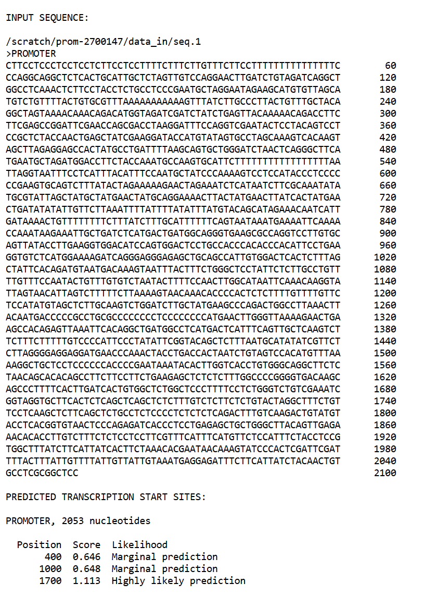 | 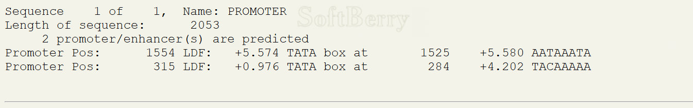 |

**CpG Finder** returned **zero CpG islands** at ~43% GC. CpG-poor promoters are the signature of regulated, tissue-restricted expression — housekeeping genes sit in CpG islands.

**GTEx** closes the argument: BTN1A1 expression is a single spike in breast tissue and essentially flat everywhere else.

| | |
|:--|:--|
| 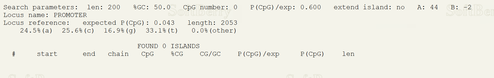 | 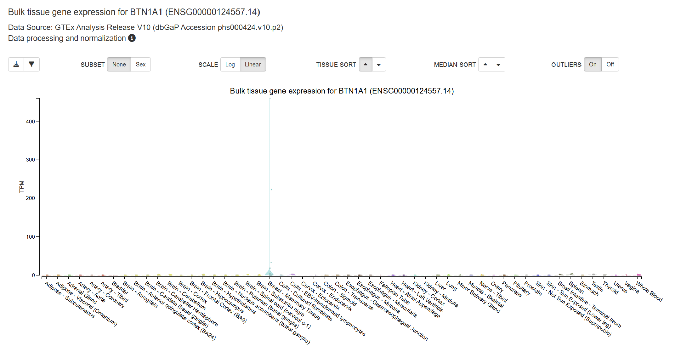 |

Promoter architecture and expression data agree independently.

---

## 2 · The gene was assembled by exon shuffling

BLASTn of the full 5,121 bp sequence hit the *Mus musculus* **Fc alpha/mu receptor (Fcamr)**, AB071978.1 — **99.66% identity, E = 0.0**, but only **71% query coverage**. High identity with incomplete coverage means part of the sequence has no counterpart in any known Fc receptor.

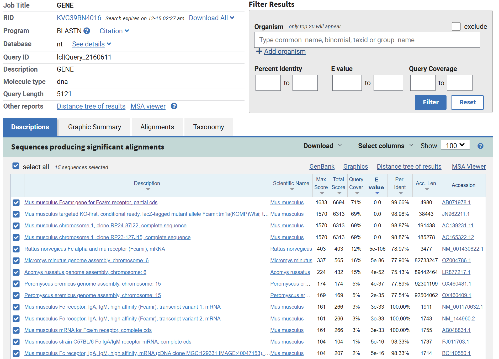

Running each exon separately shows where:

| Exon | Coordinates | Best hit | Identity | Coverage |
|:--|:--|:--|:--|:--|
| 1 | 1–510 | Fc receptor family, murine Fcamr clones | 96.7% | 83% |
| 2 | — | *no significant similarity* | — | — |
| 3 | — | *no significant similarity* | — | — |
| 4 | — | *no significant similarity* | — | — |
| 5 | 3672–5121 | Fc receptor, multiple rodent species | 100% | 46% |

Conserved exons flanking three exons with no detectable homology is the pattern **exon shuffling** produces: existing functional exons recombined with novel or rapidly diverging sequence. Gradual divergence from one ancestor would degrade the whole gene, not three interior exons while leaving the flanks at 96–100%.

**BLAST2seq** aligned genomic to mRNA at 100% identity across aligned regions (~51% coverage), confirming the exon boundaries and intron removal.

**ORF Finder** (minimum 300 nt — eukaryotic proteins below ~100 aa are rarely functional, and the threshold removes intronic and repeat-driven artifacts) returned two ORFs on the positive strand. **ORF1 spans 424–1905 nt (1,482 nt) and encodes 493 amino acids.**

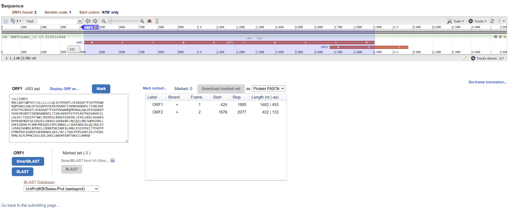

---

## 3 · The protein is a transmembrane receptor kinase

**BLASTp** of the 493 aa product returned uncharacterized and hypothetical protein kinases across protists, amoebae, and early eukaryotes — 45–50% identity, 50–54% coverage, E-values from e-61 to e-64. Many hits were protein-kinase-like or CaMK-related. A conserved catalytic domain inside a protein with no characterized ortholog in higher eukaryotes.

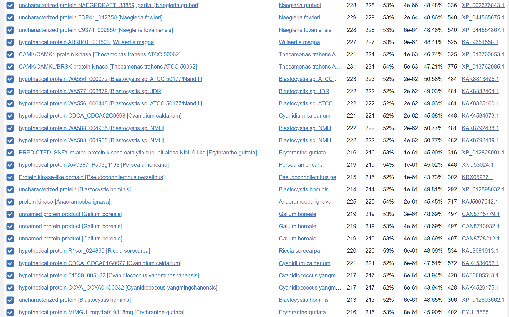

**CD-Search** resolved the architecture:

| Domain | Accession | Residues | E-value |
|:--|:--|:--|:--|
| Ser/Thr kinase catalytic (S_TKc) | smart00220 | 238–493 | 8.2 × 10⁻¹⁴⁹ |
| Immunoglobulin V-type | smart00406 | 30–109 | — |
| Immunoglobulin V-type | smart00406 | 110–189 | — |

**PROSITE** independently confirmed both: Ig-like domain signatures (PS50835) in each extracellular region, with the conserved cysteines that form the Ig disulfide bond, and the protein kinase signature (PS50011) across the catalytic domain including ATP-binding motifs and the active-site proton acceptor.

| | |
|:--|:--|
| 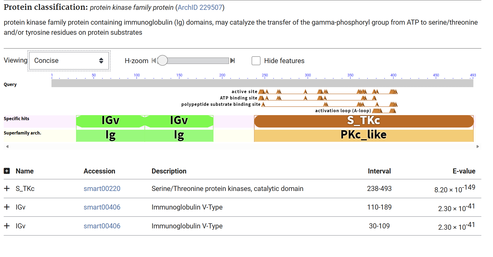 | 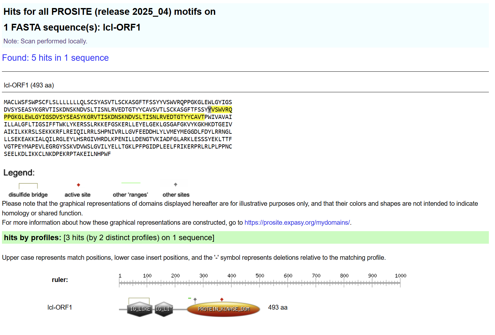 |

**SignalP 6.0** predicted an N-terminal Sec/SPI signal peptide cleaved between residues 29 and 30 (probability 0.949) — the mature protein begins immediately upstream of the Ig domains.

**DeepTMHMM** predicted one transmembrane helix at residues 193–213:

```
1 ─────── 25 │ 26 ──────── 192 │ 193 ─── 213 │ 214 ───────── 493
  signal      │  extracellular  │  TM helix   │  cytoplasmic
  peptide     │  2 × IgV        │             │  S/T kinase
```

A type I single-pass membrane protein with ligand-binding domains outside and catalysis inside — the canonical receptor kinase layout.

| | |
|:--|:--|
| 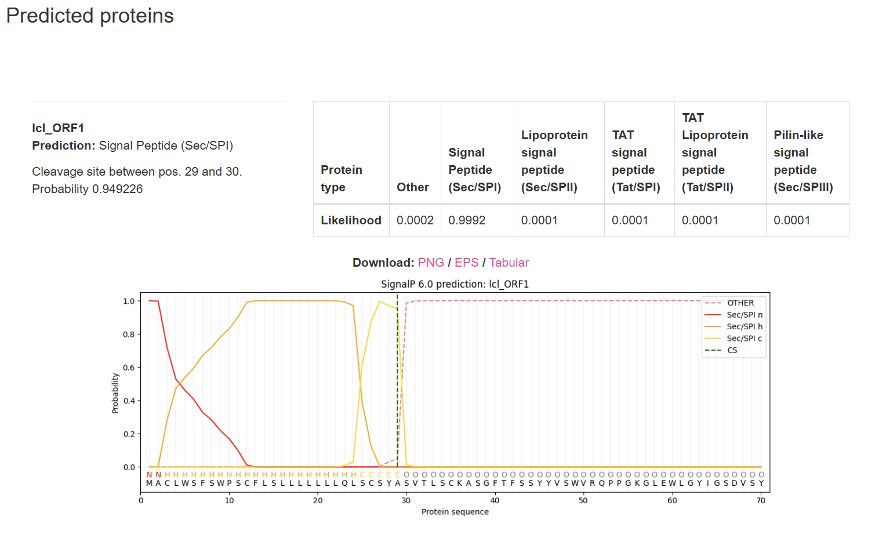 | 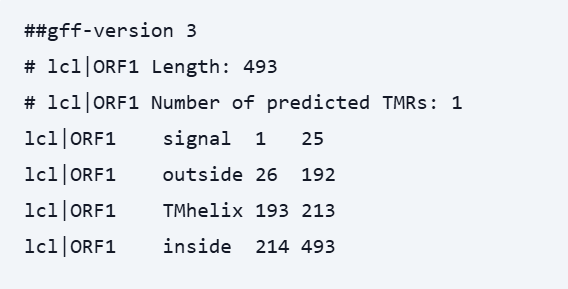 |

**PSIPRED** matched the domain assignment: β-strand-rich N-terminus as Ig domains require, mixed α/β with connecting coils in the C-terminal kinase region.

**SWISS-MODEL** built a model on template 4czt.2.A (CIPK23, a CBL-interacting Ser/Thr kinase) at 40% identity across the modeled region, returning a homodimer consistent with PDB 7YTE, an Fcμ receptor domain of 9 β-sheets and 3 α-helices.

| | |
|:--|:--|
| 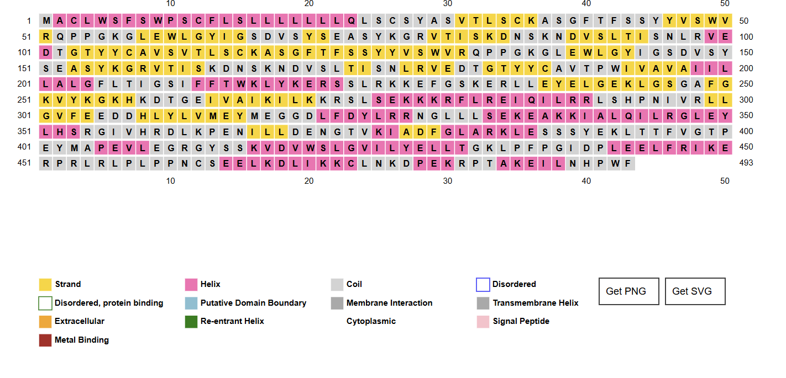 | 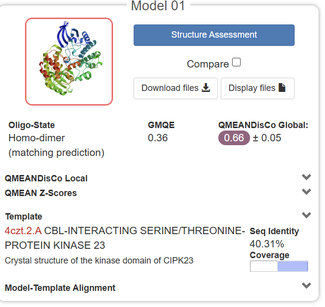 |

---

## Conclusion

The gene encodes a **membrane-associated signaling kinase expressed in mammary tissue**. Extracellular Ig-like domains mediate ligand or protein–protein interaction at the cell surface; the intracellular kinase domain transduces that signal by phosphorylation. Its five exons map onto distinct functional regions rather than splitting one continuous domain — consistent with assembly by recombination rather than by fragmentation of an ancestral gene.

Mammary epithelium depends on tightly regulated signaling for differentiation, proliferation, and remodeling, and a CpG-poor, TATA-containing, breast-restricted promoter is what a gene serving that role would carry.

---

## Limitations

- Every conclusion is **computational prediction**. No expression, localization, or kinase activity was measured.
- The IgV + Ser/Thr kinase combination is unusual, and BLASTp's closest relatives are uncharacterized proteins in distant taxa. Experimental validation would be required before calling this a receptor kinase.
- The 71% query coverage against Fcamr is the central observation, and it is also the weakest point: low coverage can reflect assembly or annotation gaps as well as genuine novelty.
- Exon shuffling is the best explanation for the conserved/non-conserved alternation, not a proven one. Synteny analysis across rodent genomes would test it.

---

## Reproducing this

The assigned sequences are course material and are not redistributed here. The analysis can be repeated against the public records it resolved to:

| Record | Accession |
|:--|:--|
| BTN1A1 promoter and complete CDS (*M. musculus*) | [U67065.1](https://www.ncbi.nlm.nih.gov/nuccore/U67065.1) |
| Fc alpha/mu receptor (*M. musculus*) | [AB071978.1](https://www.ncbi.nlm.nih.gov/nuccore/AB071978.1) |
| BTN1A1 expression | [GTEx](https://gtexportal.org/home/gene/BTN1A1) |
| Fcμ receptor structure reference | [PDB 7YTE](https://www.rcsb.org/structure/7YTE) |

## Tools

[BLAST](https://blast.ncbi.nlm.nih.gov/Blast.cgi) ·
[ORF Finder](https://www.ncbi.nlm.nih.gov/orffinder/) ·
[CD-Search](https://www.ncbi.nlm.nih.gov/Structure/cdd/wrpsb.cgi) ·
[PROSITE](https://prosite.expasy.org/) ·
[SignalP 6.0](https://services.healthtech.dtu.dk/services/SignalP-6.0/) ·
[DeepTMHMM](https://dtu.biolib.com/DeepTMHMM) ·
[PSIPRED](http://bioinf.cs.ucl.ac.uk/psipred/) ·
[SWISS-MODEL](https://swissmodel.expasy.org/) ·
[FPROM](http://www.softberry.com/berry.phtml?topic=fprom) ·
[CpG Finder](http://www.softberry.com/berry.phtml?topic=cpgfinder) ·
[PROMO](https://alggen.lsi.upc.es/cgi-bin/promo_v3/promo/promoinit.cgi) ·
[GTEx](https://gtexportal.org/)

---

Final project, Introduction to Bioinformatics, M.S. Bioinformatics, Johns Hopkins University — Fall 2025.
